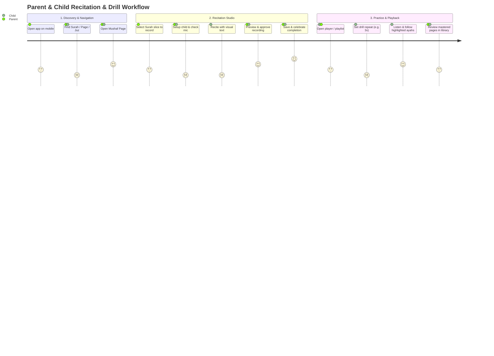
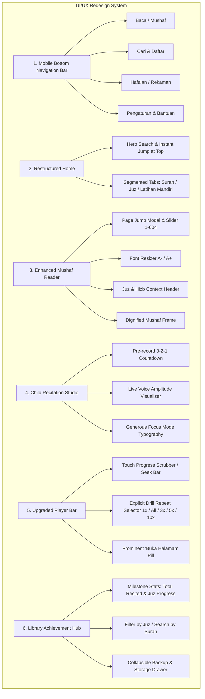

# ngajiPlay — UI/UX Assessment & Redesign Task Breakdown

**Status:** Proposed & actionable design specification  
**Context:** Builds upon [REQ.md](REQ.md) and [TASKS.md](TASKS.md) (Phases 0–9C)  
**Author:** Antigravity UI/UX Audit  

---

## Part 1: Comprehensive UI/UX Assessment

### 1. Executive Summary & Product Thesis

**ngajiPlay** has a clear, noble, and well-executed technical core: an offline-first PWA where parents record their child reciting a surah portion of a Madani Quran page, and the child listens back to their own recitation while following along on the exact same page for memorization (*tahfiz/muroja'ah*).

The engineering foundation is exceptionally disciplined:
- Pure vanilla TypeScript without heavy UI framework overhead.
- Strict size budget (under 1.5 MB gzipped, currently measuring ~390 KB gzipped / 1.6 MB raw).
- Resilient offline PWA architecture with explicit service worker caching and IndexedDB blob persistence.
- Verified 604-page Madani mushaf mapping and Amiri Quran font subsetting.

However, from a **Human-Computer Interaction (HCI) and user experience perspective**, the application currently presents like an engineering-driven file utility rather than an engaging, intuitive, and spiritually dignified learning companion.

#### The Dual-Persona Dynamic
The application must cater simultaneously to two distinct users sharing one device:
1. **The Parent (Facilitator & Coach)**:
   - Needs frictionless navigation to specific Surahs, Ayahs, Pages, and Juz.
   - Needs absolute confidence during recording: Is the microphone working? Is the child loud enough? Is the recording saved safely?
   - Manages storage, file exports, and optional Google Drive backups without being overwhelmed by technical jargon.
2. **The Child (Reciter & Listener / Learner)**:
   - Needs large, crystal-clear Arabic text that doesn't feel cramped or require fiddly scrolling while reciting.
   - Needs gentle pacing and breathing room (a preparation countdown before recording begins).
   - Needs intuitive, tactile controls to replay and drill their own voice (e.g., repeating a slice 3× or 5× for memorization).
   - Needs a sense of accomplishment, warmth, and joy (celebrating completed surahs, seeing their progress grow).

---

### 2. User Journey & Friction Mapping

---

### 3. Screen-by-Screen Heuristic Audit

#### 3.1. Header Chrome & Primary Navigation (`src/ui/` & `src/main.ts`)
* **Current State**:
  - The top bar displays the brand logo (`ngajiPlay`) on the left.
  - On the right sits a tight row of five unlabelled controls:
    1. Language toggle (`ID` / `EN`).
    2. How-to button (`?`).
    3. Install button (conditionally shown).
    4. Settings link (cog icon).
    5. Library link (books icon).
    6. Offline status indicator (a 10px circular `.dot` with tooltip).
* **Friction Points**:
  - **Heuristic: Recognition Rather Than Recall**: The icons lack text labels. First-time parents do not inherently know that the three vertical book spines icon represents their child's recorded clips.
  - **Ergonomics (The Mobile Thumb Zone)**: On modern 6.1"–6.8" smartphones, reaching top-right icons with one hand causes physical strain.
  - **Cryptic System Status**: The status dot (`ready`, `firstLoad`, `offline`, `noSw`) is completely invisible in its meaning unless hovered with a mouse cursor (impossible on touchscreens) or inspected via screen readers.
  - **Lack of Persistent Navigation**: Navigating between "Reading Quran", "Searching", and "Reviewing Recordings" relies on repetitive breadcrumb taps (`‹ Cari halaman`), creating disorientation.

---

#### 3.2. Home & Search Screen (`src/ui/search-view.ts`)
* **Current State**:
  The view renders in this linear order:
  1. `pagePlaylist()`: Advanced multi-page batch playlist form (`Halaman: 506, 507`, `Ulangi daftar: 1x`).
  2. `indexSlot`: A full 114-surah grid (`.surah-grid`) with a height ceiling of 58vh / 560px.
  3. `form`: The search input box (`Cari halaman atau surah`).
  4. `results`: List of search hit cards.
* **Friction Points**:
  - **Inverted Visual Hierarchy**: Placing the technical multi-page playlist input at the very top overwhelms new users. Most users visit this screen simply to find a surah or page.
  - **Buried Search Input**: The primary search box is placed *below* both the playlist form and the 114-item surah grid. Users have to scroll past screens of content to reach the search field.
  - **No Juz Structure**: In Quran education and Tahfiz curricula worldwide, lessons are organized by **Juz** (especially Juz 30 / Juz 'Amma, Juz 29, etc.). Currently, Juz is completely absent from the UI and search metadata.

---

#### 3.3. Mushaf Reading Page (`src/ui/page-view.ts` & `src/ui/mushaf.ts`)
* **Current State**:
  - Pager bar: `‹ Halaman 42 dari 604 ›`.
  - Mushaf text: Subtitled Amiri Quran font, justified layout, inline ayah medallions, surah header banners.
  - Bottom section: "Bagian halaman ini" with slice cards showing recording status, play button, and record trigger.
* **Friction Points**:
  - **Navigation Friction**: Moving across pages (e.g., from Page 1 to Page 20) requires tapping `›` 19 times or returning to search. There is no rapid page slider or direct jump modal.
  - **Fixed Font Size**: The font size is hardcoded to `--mushaf-size: 26px; line-height: 2;`. For a child sitting at a distance, on a tablet stand, or on a compact phone, this cannot be adjusted. There is no `A-` / `A+` font resizer.
  - **Plain Canvas Atmosphere**: The page renders as basic text on an off-white background with thin horizontal rules (`--rule: #e7e0cf`). It lacks the dignified visual framing (*mushaf frame*) that evokes the reverence of the printed Quran.

---

#### 3.4. Recording Studio Flow (`src/ui/record-panel.ts`)
* **Current State**:
  - Tapping a slice opens an inline panel directly above the slice list.
  - Displays the slice title, a duplicate scrollable text box (`max-height: 34vh`), a plain text timer (`0:00`), and action buttons (`Mulai merekam`, `Berhenti`, `Simpan`, etc.).
* **Friction Points**:
  - **Claustrophobic Recitation Box**: The child was just looking at the full page, but the recorder shrinks the recitation text into a cramped 34vh scrollable sub-container. Children easily lose their place when text scrolls inside a small window.
  - **No Live Audio Feedback ("Dead Mic" Anxiety)**: The timer ticks (`0:01, 0:02...`) but there is **zero visual feedback on microphone input** (no waveform, no volume bar, no voice pulse). Parents constantly worry whether the microphone is picking up sound or if the child is reciting too softly.
  - **No Preparation Countdown**: Pressing "Mulai merekam" immediately engages the recorder without a 3-second breathing cue (3... 2... 1... *Bismillah!*), frequently clipping the child's opening *Ta'awwudz*.

---

#### 3.5. Player Bar & Memorization Drills (`src/ui/player-bar.ts`)
* **Current State**:
  - Bottom-anchored drawer showing clip name, page link, repeat button, prev/play/next buttons, and timestamps (`0:14 · 0:45`).
* **Friction Points**:
  - **No Seek Bar / Progress Scrubber**: The player lacks any interactive progress bar or scrubbing slider. If a child makes a pronunciation error at second 42 of a 50-second clip, the parent cannot scrub forward—they must listen from 0:00 or restart.
  - **Cryptic Repeat Button**: The button cycles through `Off → 1 → All → 2 → 3 → 5 → 10`. To an uninitiated parent or child, seeing a solitary button with `2` or `10` is confusing (they wonder if it means Track 2 or 10 seconds, rather than repeating each clip N times for memorization drill).
  - **Hidden "Follow" Control**: The button to return to the active playing ayah on the mushaf is tucked away in the right action group and only appears under specific conditions.

---

#### 3.6. Library & Practice Hub (`src/ui/library-view.ts`)
* **Current State**:
  - Single linear vertical list of recorded clips ordered strictly by page and surah.
  - Technical storage lines, persistence notifications, Google Drive connect button, and folder export buttons sit directly at the top.
* **Friction Points**:
  - **Technical Clutter Above Child Content**: Storage statistics (`Penyimpanan: 1.2 MB terpakai dari 2.4 GB...`) dominate the top of what should be a proud showcase of the child's recitations.
  - **Lack of Filtering or Grouping**: As a child records 20–50 clips, finding a specific surah requires endless scrolling. There is no filter by Surah or Juz.
  - **Missing Sense of Accomplishment**: Recording the Quran is a major milestone for a child. A flat list of filenames and byte sizes feels sterile. It lacks celebratory indicators like completion stars, total minutes recited, or a "Hafalan Selesai" badge.

---

### 4. Proposed Redesign Architecture

---

## Part 2: Implementation Breakdown into Tasks

The tasks below follow the exact conventions of [TASKS.md](TASKS.md):
- Every task specifies the files to touch and the requirement it satisfies.
- Strictly adheres to the **1.5 MB gzipped size budget** (NFR-1) and **pure vanilla TypeScript** architecture.
- Preserves all existing `data-testid` attributes to ensure zero regression in the existing unit test (140 tests) and e2e test suites.

---

### Phase 10A — Navigation & Shell Ergonomics

**Goal:** Establish mobile-first bottom navigation, simplify top chrome, and improve one-handed phone ergonomics.

- [x] **10A.1 Mobile Bottom Navigation Bar (`src/ui/bottom-nav.ts`, `src/styles.css`)**
  - Implement a persistent bottom navigation bar on mobile viewports (< 768px):
    1. **Mushaf (Baca)**: Direct jump to the current/last-read page (`#/p/:page`).
    2. **Cari & Indeks**: Opens the search & index screen (`#/`).
    3. **Hafalan**: Opens the Library screen (`#/library`).
    4. **Pengaturan**: Opens Settings, Backup & Help (`#/settings`).
  - Use lightweight inline SVGs matching the existing design system.
  - Active tab highlighting with `--deep` (#0e4a3c) tint and accessible ARIA attributes (`aria-current="page"`).
  - Adjust `body` bottom padding dynamically to avoid overlapping the player bar and bottom nav.
- [x] **10A.2 Streamlined Header Chrome (`src/main.ts`, `index.html`, `src/styles.css`)**
  - Move secondary utility links (How-To modal, Settings, Library) from the top header into the bottom navigation / settings tab.
  - Retain brand logo (`ngajiPlay`), a clear readable status pill (`Online` / `Siap Offline` instead of the cryptic dot), and the language toggle (`ID/EN`).
  - Ensure desktop viewports (≥ 768px) maintain an elegant top navigation layout without unnecessary clutter.
- [x] **10A.3 Automated & Visual Verification**
  - Add Playwright e2e test in `tests/e2e/ui.spec.ts` verifying tab switching, route updates, and accessibility attributes.
  - Verify zero console errors, zero regressions in `tests/e2e/shell.spec.ts`, and size check pass.

**Done when:** The app has a comfortable, 4-tab bottom navigation on mobile devices, header clutter is resolved, and navigation between Mushaf, Search, and Library is 1-tap accessible.

---

### Phase 10B — Home Screen & Search Re-architecture

**Goal:** Eliminate inverted visual hierarchy, place search and instant page jump at the top, and introduce Juz categorization.

- [ ] **10B.1 Top Hero Search & Instant Page Jump (`src/ui/search-view.ts`, `src/styles.css`)**
  - Re-order `renderSearch()`: Place the search form and instant jump input at the **very top** of `#view`.
  - Enhance input placeholder: `"Ketik nomor halaman (1–604) atau nama surah..."`.
  - Add instant numeric page jump: Typing a valid number (e.g. `42`) shows a prominent `"Buka Halaman 42"` direct action chip.
- [ ] **10B.2 Segmented View Tabs: Surah Index vs. Juz Index vs. Latihan (`src/ui/search-view.ts`)**
  - Introduce clean tab buttons below the search bar:
    - **Tab 1: Daftar Surah (1–114)** (Default).
    - **Tab 2: Daftar Juz (Juz 1–30)** (Essential for Tahfiz curricula).
    - **Tab 3: Latihan Mandiri (Multi-Page Drill)** (Relocated from the top).
  - Persist active tab selection during the session.
- [ ] **10B.3 Juz Index Component (`src/data/quran.ts`, `src/ui/juz-index.ts`)**
  - Add standard Madani Juz page mapping data helper (`juzStartPage(juzNumber)`).
  - Render 30 clean cards showing: Juz number, Arabic name / opening surah, page range (e.g. *Juz 30: An-Naba' – An-Nas · Hal 582–604*), and an indicator of how many clips are recorded in that Juz.
- [ ] **10B.4 Repositioned Multi-Page Playlist ("Latihan Mandiri") (`src/ui/page-playlist.ts`)**
  - Move `pagePlaylist()` into Tab 3 with an inviting title and helper text: *"Putar Rangkaian Halaman untuk Muroja'ah"*.
  - Keep all existing IDs (`playlist-pages`, `playlist-repeat`, `playlist-play`) so tests pass without alteration.
- [ ] **10B.5 Automated & Visual Verification**
  - Unit tests for Juz data mappings in `tests/unit/quran-data.test.ts`.
  - E2e tests in `tests/e2e/search.spec.ts` verifying instant search at the top, tab toggles, and Juz navigation.

**Done when:** Opening the app immediately presents a clear search input and instant page jump, surahs and juzs are browseable via tabs, and the multi-page drill is housed in its own organized section.

---

### Phase 10C — Mushaf Reading & Page Navigation Ergonomics

**Goal:** Add direct page jump slider/modal, Juz context indicator, font size scaling, and dignified mushaf framing.

- [x] **10C.1 Quick Page Jump Modal / Slider (`src/ui/page-view.ts`, `src/styles.css`)**
  - Tapping the pager label (`Halaman 42 dari 604`) opens a lightweight, accessible dialog:
    - Direct numeric input for page number (1–604) with automatic validation.
    - Quick-scrubber slider (`<input type="range" min="1" max="604">`) for rapid browsing.
    - Quick shortcut chips: `Juz 1`, `Juz 15`, `Juz 30 (Juz 'Amma)`.
- [x] **10C.2 Juz Context & Page Header (`src/ui/page-view.ts`, `src/data/quran.ts`)**
  - Calculate active Juz for the current page.
  - Display subtle, elegant running header above the mushaf text: e.g. `Juz 30 · Surah Al-Ikhlas`.
- [x] **10C.3 Dynamic Font Resizer (`src/ui/page-view.ts`, `src/styles.css`)**
  - Add small, unobtrusive `A-` and `A+` scale controls in the page action bar.
  - Adjust `--mushaf-size` between 22px and 34px (respecting proportional line-height to prevent diacritic collision).
  - Persist chosen font scale to `localStorage` / settings.
- [x] **10C.4 Mushaf Framing & Tactile Slice Cards (`src/styles.css`, `src/ui/page-view.ts`)**
  - Style `.mushaf` with a refined inner border and warm canvas tone reminiscent of a Madani Quran copy.
  - Enhance slice cards at page bottom:
    - Clear recorded status pill: `✓ Sudah Direkam (0:45)` in soft green vs. `○ Belum Direkam`.
    - Prominent circular Play button for recorded slices and dedicated "Rekam" action button.
- [x] **10C.5 Automated & Visual Verification**
  - Unit test for page-to-juz mapping.
  - E2e test in `tests/e2e/ui.spec.ts` verifying page jumping via modal, font scaling persistence, and slice actions.

**Done when:** A user can jump to any of the 604 pages instantly via slider or numeric input, adjust Arabic text size comfortably, see the active Juz, and read on an aesthetically framed mushaf canvas.

---

### Phase 10D — Recitation Studio Polish

**Goal:** Eliminate "dead mic" anxiety, provide child-friendly preparation, and offer a spacious recitation layout.

- [ ] **10D.1 Pre-Recording 3-2-1 Countdown Cue (`src/ui/record-panel.ts`, `src/styles.css`)**
  - When the parent taps "Mulai merekam", display a cheerful, smooth 3... 2... 1... countdown overlay before audio capture begins.
  - Provide an optional "Lewati Countdown" button for quick retakes.
  - Gives the child time to inhale, prepare, and start smoothly with *Ta'awwudz*.
- [ ] **10D.2 Live Microphone Amplitude Visualizer (`src/ui/record-panel.ts`, `src/recording/recorder.ts`)**
  - Hook an `AudioContext` and `AnalyserNode` to the active `MediaStream` during recording.
  - Render a lightweight, responsive volume pulse ring or audio waveform bar below the timer:
    - Glowing emerald green wave when voice input is detected.
    - Soft amber warning if input volume is too low (mic too far away).
  - Zero external libraries (uses native Web Audio API, ~1.5 KB code, zero bundle impact).
- [ ] **10D.3 Full-Focus Recitation Sheet (`src/ui/record-panel.ts`, `src/styles.css`)**
  - Expand the recitation panel into a distraction-free recitation view:
    - Increase font size to 32px for the active slice text.
    - Eliminate awkward inner scrollbars for standard-length slices.
    - Emphasize the current ayah range clearly.
- [ ] **10D.4 Enhanced Touch Preview Controls (`src/ui/record-panel.ts`)**
  - Replace raw browser `<audio>` controls with custom, touch-friendly preview buttons (large Play/Pause, clear waveform/scrubber, and prominent "Simpan Rekaman" vs "Rekam Ulang" buttons).
- [ ] **10D.5 Automated & Visual Verification**
  - Verify mic teardown and `AudioContext` closure on cancel/exit.
  - Playwright test verifying recording flow with countdown and preview actions.

**Done when:** Recording begins with an encouraging 3-2-1 countdown, live voice volume is visually confirmed during recitation, and text is displayed spaciously without claustrophobic scrolling.

---

### Phase 10E — Player Bar & Memorization Drill Enhancements

**Goal:** Add a draggable audio progress scrubber and make memorization drill repeat modes clear and educational.

- [x] **10E.1 Interactive Progress Scrubber / Seek Bar (`src/ui/player-bar.ts`, `src/playback/player.ts`)**
  - Add `<input type="range" class="player-scrubber">` directly above or inline with the player controls.
  - Two-way binding with `player.currentTime`:
    - Updates smoothly as the audio plays.
    - Seeking/dragging instantly updates audio playback position.
  - Retain `player-elapsed` and `player-remaining` time readouts.
- [x] **10E.2 Explicit Drill Repeat Sheet / Popover (`src/ui/player-bar.ts`, `src/strings.ts`)**
  - Tapping the repeat button opens an educational drill selector modal/popover:
    - **1× (Putar Sekali)**: Normal single playback.
    - **Semua (Ulangi Halaman)**: Loops the current page playlist.
    - **Drill 3× (Tahfiz Pemula)**: Repeats each clip 3 times before advancing.
    - **Drill 5× (Muroja'ah)**: Repeats each clip 5 times for memorization stability.
    - **Drill 10× (Ujian Hafalan)**: Deep memorization repetition.
  - The repeat button reflects the active mode clearly (e.g. `3× Drill` instead of bare `3`).
- [x] **10E.3 Prominent "Buka Halaman" Navigation Pill (`src/ui/player-bar.ts`)**
  - When playing audio from another view (e.g. while in Library or Search), provide a prominent chip: `"Lihat Halaman 42 ↗"`.
  - Instantly jumps to that page with the playing ayahs glowing in soft emerald.
- [x] **10E.4 Automated & Visual Verification**
  - Unit test in `tests/unit/player.test.ts` verifying scrubbing and repeat mode states.
  - Playwright test in `tests/e2e/player.spec.ts` testing seeking and repeat selection.

**Done when:** The player bar has a touch-friendly scrubber for forward/rewind seeking, memorization drill repeats are clearly explained and selected, and jumping back to the active page is seamless.

---

### Phase 10F — Library Achievement Hub & Organization

**Goal:** Transform the library from a raw file list into an inspiring accomplishment hub with filtering, stats, and clean backup drawer.

- [ ] **10F.1 Child Achievement & Milestone Header (`src/ui/library-view.ts`, `src/styles.css`)**
  - Replace the technical storage bars at the top with inspiring progress metrics:
    - E.g.: `★ 18 Rekaman · 42 Menit Total Bacaan · Juz 30 (65% Lengkap)`.
    - Encourages the child and provides immediate insight to the parent.
- [ ] **10F.2 Filter by Juz & Fast Search (`src/ui/library-view.ts`)**
  - Add quick filter chips at top of library: `Semua`, `Juz 30 (Juz 'Amma)`, `Juz 29`, etc.
  - Add a quick filter search box to find specific surahs instantly without endless scrolling.
- [ ] **10F.3 "Putar Semua" (Play All) Action (`src/ui/library-view.ts`, `src/playback/player.ts`)**
  - Add a prominent primary button: `"Putar Semua Rekaman (18)"`.
  - Immediately loads the entire library (or filtered Juz) into the player queue and begins playback.
- [ ] **10F.4 Collapsible "Cadangan & Penyimpanan" Drawer (`src/ui/library-view.ts`)**
  - Tidy technical elements (Google Drive sync, folder export, storage quota, persistence) inside a neat collapsible section: `⚙️ Cadangan & Penyimpanan ▾`.
  - Keeps the main library view 100% focused on the child's recitations while preserving full backup functionality.
- [ ] **10F.5 Automated & Visual Verification**
  - Unit and e2e tests in `tests/e2e/library.spec.ts` verifying filtering, Play All queue generation, and backup drawer toggle.

**Done when:** The library celebrates the child's recitation milestones, supports Juz filtering and "Play All", and neatly organizes technical backup tools into a collapsible drawer.

---

## Part 3: Phasing & Priority Matrix

| Phase | Title | Primary Benefit | Complexity | Size Budget Impact |
|:---:|---|---|:---:|:---:|
| **10A** | **Navigation & Shell Ergonomics** | 1-thumb phone accessibility & bottom nav | Low-Medium | +1.5 KB |
| **10B** | **Home & Search Re-architecture** | Immediate discovery; search at top; Juz index | Low | +2.0 KB |
| **10C** | **Mushaf Reading Ergonomics** | Direct page jump modal; font resizer; Juz context | Medium | +2.5 KB |
| **10D** | **Recitation Studio Polish** | Live voice visualizer; 3-2-1 countdown; focus mode | Medium | +2.5 KB |
| **10E** | **Player Bar & Drill Modes** | Scrubber seek bar; clear tahfiz repeat presets | Low-Medium | +1.8 KB |
| **10F** | **Library Achievement Hub** | Juz filters; Play All; celebration stats; clean backup | Medium | +2.0 KB |

*Total estimated footprint: ~12 KB raw (~3 KB gzipped), keeping the total build at ~394 KB gzipped — well beneath the 1.5 MB NFR-1 ceiling.*

